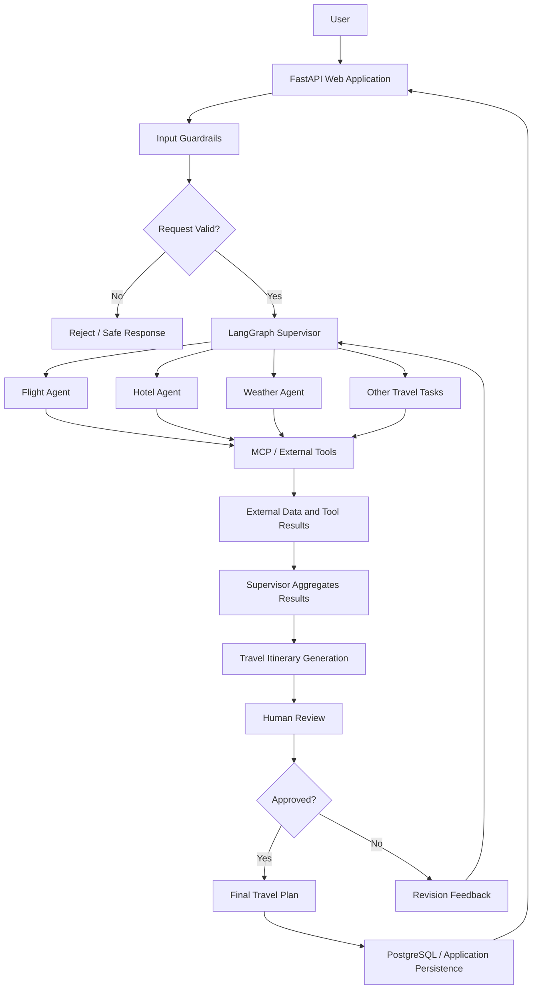
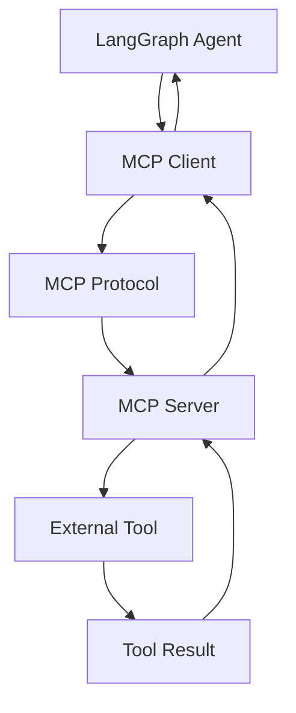
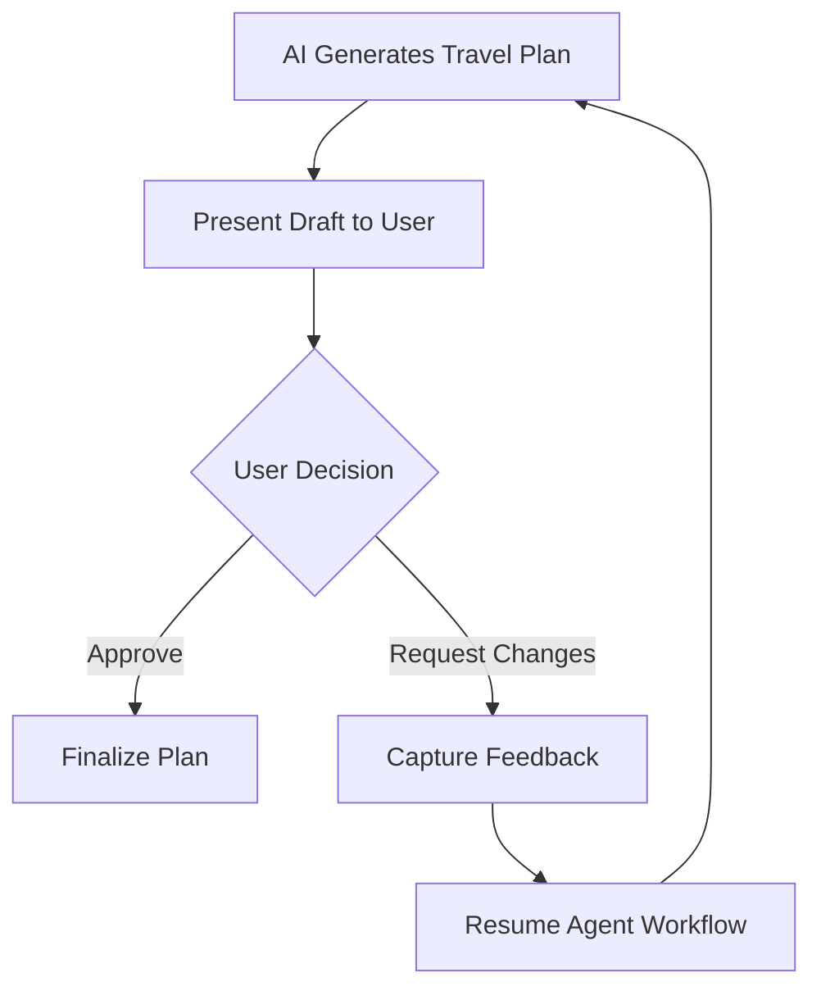

# TripWithKesAI – Multi-Agent AI Travel Planner

<p align="center">
  <strong>An Agentic AI Travel Planning System powered by LangGraph, MCP, Supervisor Architecture, Guardrails, and Human-in-the-Loop Approval.</strong>
</p>

<p align="center">
  
  
  
  
  
  
</p>

---

## Overview

**TripWithKesAI** is an Agentic AI-powered travel planning application that uses multiple specialized AI agents to understand user requirements, research travel information, and generate personalized travel itineraries.

Instead of relying on a single LLM response, the system uses a **Supervisor-based multi-agent architecture** built with LangGraph. The supervisor coordinates specialized agents, manages their execution, and combines their results into a travel plan.

The application integrates the **Model Context Protocol (MCP)** to connect agents with external tools and services. It also implements input guardrails and Human-in-the-Loop (HITL) approval to make the planning workflow more controlled and reviewable.

Users can interact with the application through a web interface, receive a generated travel plan, and approve it or request revisions.

## Key Features

- **Multi-Agent Architecture:** Multiple specialized agents handle different travel-planning responsibilities.
- **Supervisor Agent:** Coordinates agents and manages the overall workflow.
- **LangGraph Orchestration:** Defines agent execution, state management, routing, and workflow transitions.
- **MCP Integration:** Connects AI agents with external tools through the Model Context Protocol.
- **Input Guardrails:** Validates user requests before processing.
- **Human-in-the-Loop (HITL):** Allows users to review generated plans and approve or request changes.
- **Flight Research:** Dedicated flight agent for travel-related flight information.
- **Hotel Research:** Hotel agent with MCP-based search capabilities.
- **Weather Information:** Weather agent for destination-related information.
- **Travel Itinerary Generation:** Combines agent results into a personalized travel plan.
- **PostgreSQL Integration:** Persistent database connectivity for application data and workflow-related records.
- **FastAPI Backend:** Provides HTTP endpoints for the web application.

## Technology Stack

| Category                               | Technologies            |
| -------------------------------------- | ----------------------- |
| Programming Language                   | Python                  |
| AI Framework                           | LangChain               |
| Agent Orchestration                    | LangGraph               |
| Agent Communication / Tool Integration | MCP                     |
| LLM Provider                           | Groq                    |
| LLM Model                              | Configurable Groq model |
| Web Backend                            | FastAPI                 |
| ASGI Server                            | Uvicorn                 |
| Database                               | PostgreSQL              |
| Web Search                             | Tavily                  |
| Frontend                               | HTML, CSS, JavaScript   |
| Workflow Control                       | LangGraph StateGraph    |
| Human Approval                         | Human-in-the-Loop       |
| Configuration                          | Python dotenv           |
| Async Support                          | asyncio, nest_asyncio   |
| Version Control                        | Git and GitHub          |

## System Architecture

The system follows a supervisor-based architecture. The supervisor receives a user request, coordinates specialized agents, and collects their outputs.



## Multi-Agent Workflow

Each agent has a specialized responsibility.

| Agent               | Responsibility                                      |
| ------------------- | --------------------------------------------------- |
| Supervisor Agent    | Coordinates agents and controls workflow execution. |
| Guardrail Component | Validates and filters incoming requests.            |
| Flight Agent        | Handles flight-related research.                    |
| Hotel Agent         | Handles hotel and accommodation research.           |
| Weather Agent       | Retrieves destination weather information.          |
| MCP Tools           | Provide access to external services and tools.      |
| HITL Approval       | Allows users to approve or request revisions.       |

### 1. Supervisor Architecture

The Supervisor acts as the central coordinator of the application.

Its responsibilities include:

- Understanding the user's travel requirements.
- Determining which specialized agents are required.
- Coordinating agent execution.
- Managing workflow transitions.
- Collecting agent responses.
- Combining information into a travel plan.

### 2. Model Context Protocol (MCP)

MCP enables AI agents to interact with external tools through a standardized protocol.

In this project, MCP is used to connect agent workflows with external services such as weather and search capabilities.



### 3. Guardrails

Guardrails help validate incoming requests before they enter the main agent workflow.

They provide a controlled entry point for handling invalid or inappropriate requests.

### 4. Human-in-the-Loop (HITL)

Human-in-the-Loop introduces a manual approval stage into the AI workflow.



This approach makes it possible to review AI-generated results before final approval.

## Project Structure

```text
Multi-Agent-System-using-LangGraph-MCP-Supervisor-Guardrails-HITL/
│
├── app.py
│
├── backend.py
│
├── mcp_client.py
│
├── custom_weather_mcp_server.py
│
├── templates/
│   └── index.html
│
├── static/
│   ├── style.css
│   └── script.js
│
├── requirements.txt
│
├── .env
├── .env.example
│
├── .gitignore
│
└── README.md
```

**Main files:**

| File                           | Description                                                  |
| ------------------------------ | ------------------------------------------------------------ |
| `app.py`                       | FastAPI application, frontend routes, and API endpoints.     |
| `backend.py`                   | Core LangGraph workflow and travel agent orchestration.      |
| `mcp_client.py`                | MCP client integration, LLM configuration, and tool helpers. |
| `custom_weather_mcp_server.py` | Example MCP server for weather-related tools.                |
| `templates/`                   | HTML templates for the frontend.                             |
| `static/`                      | Frontend CSS and JavaScript files.                           |
| `requirements.txt`             | Python project dependencies.                                 |

## Installation and Setup

### Prerequisites

Make sure you have installed:

- Python 3.10 or higher.
- Git.
- PostgreSQL database or a configured hosted PostgreSQL instance.
- Groq API key.
- Tavily API key.

### Step 1: Clone the Repository

```bash
git clone https://github.com/entbappy/Multi-Agent-System-using-LangGraph-MCP-Supervisor-Guardrails-HITL.git
```

### Step 2: Navigate to Project

```bash
cd Multi-Agent-System-using-LangGraph-MCP-Supervisor-Guardrails-HITL
```

### Step 3: Create Virtual Environment

```bash
python -m venv .venv
```

### Step 4: Activate Virtual Environment

**Windows PowerShell:**

```powershell
.venv\Scripts\Activate.ps1
```

If PowerShell blocks activation:

```powershell
Set-ExecutionPolicy -Scope Process -ExecutionPolicy Bypass
.venv\Scripts\Activate.ps1
```

### Step 5: Install Dependencies

```bash
python -m pip install --upgrade pip
pip install -r requirements.txt
```

### Step 6: Configure Environment Variables

Create a `.env` file in the project root directory.

```env
GROQ_API_KEY=your_groq_api_key

TAVILY_API_KEY=your_tavily_api_key

DATABASE_URL=your_postgresql_connection_url
```

**API keys:**

- Groq: https://console.groq.com/keys
- Tavily: https://app.tavily.com/home
- PostgreSQL / Render: https://dashboard.render.com/

Use the model ID configured in your application and supported by your Groq account. Do not commit your `.env` file to GitHub.

### Step 7: Run the Application

```bash
python app.py
```

Alternatively, run with Uvicorn:

```bash
uvicorn app:app --reload --host 127.0.0.1 --port 8000
```

### Step 8: Open the Application

Visit:

http://127.0.0.1:8000

Your TripWithKesAI application should now be accessible locally.

## Running the Custom MCP Server

The project includes an example weather MCP server.

Open a separate terminal, activate the virtual environment, and run:

```bash
python custom_weather_mcp_server.py
```

Run it according to the transport and configuration expected by the MCP client in your project.

## API Endpoints

The FastAPI backend exposes the following application endpoints:

| Method | Endpoint              | Description                                       |
| ------ | --------------------- | ------------------------------------------------- |
| POST   | `/api/travel`         | Starts or resumes a travel-planning workflow.     |
| POST   | `/api/travel/approve` | Approves a draft or submits revision feedback.    |
| GET    | `/health`             | Checks application health and available features. |

### Example: Create a Travel Plan

**Request:**

```json
{
  "message": "Plan a 5-day trip to Goa for two people with a budget of 30000."
}
```

**Approval request:**

```json
{
  "thread_id": "your-thread-id",
  "approved": true,
  "feedback": ""
}
```

The exact request and response structures should follow the implementation in `app.py`.

## Database Integration

The project uses PostgreSQL through the `DATABASE_URL` environment variable.

PostgreSQL provides relational storage for application data and supports structured queries, relationships, and transactions.

The actual tables and persisted records depend on the database schema implemented in `backend.py`.

## Core Agentic AI Concepts Demonstrated

This project provides practical exposure to:

1. Multi-Agent Systems.
2. LangGraph StateGraph.
3. Supervisor-Based Agent Orchestration.
4. MCP Client and Server Architecture.
5. Tool Calling and External Integrations.
6. Input Guardrails.
7. Human-in-the-Loop Approval.
8. Workflow State Management.
9. Agent Execution and Routing.
10. FastAPI Backend Integration.
11. PostgreSQL Database Connectivity.
12. LLM Integration with Groq.

## Future Improvements

- Add authentication and user-specific travel history.
- Add more specialized travel agents.
- Improve flight and hotel search integrations.
- Add itinerary export to PDF.
- Add booking integrations.
- Implement advanced agent observability and execution tracing.
- Add automated tests for agent workflows.
- Improve error handling and retry mechanisms.

## Learning Outcomes

Through this project, I explored how to design and build an Agentic AI application using LangGraph and MCP.

The project demonstrates how multiple specialized agents can collaborate under a supervisor, interact with external tools, validate requests through guardrails, and involve humans in important workflow decisions.

## License

This project follows the license specified in the original repository's `LICENSE` file.


---

<p align="center">
  <strong>Built to explore Multi-Agent AI, LangGraph, MCP, and practical Agentic AI workflows.</strong>
</p>
